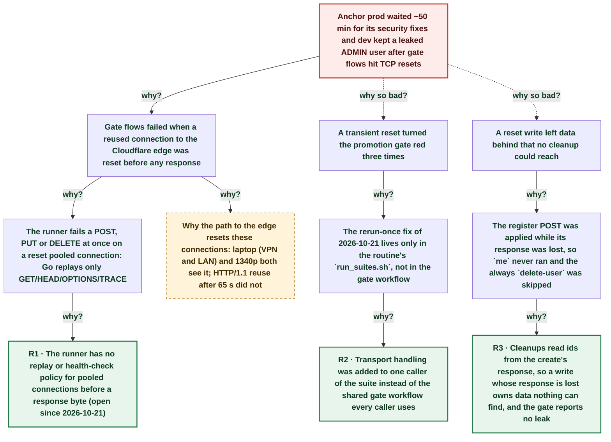

# Anchor prod held 50 min and dev leaked an admin user: gate flows failed on TCP resets the gate never reruns

| | |
|---|---|
| **Date** | 2026-11-05 |
| **Severity** | SEV4 |
| **Status** | In review |
| **Service** | ci-workflows echopoint-test (anchor post-deploy gate) |
| **Authors** | Nanostack routine (echopoint-investigation) |
| **Duration** | ~57m 31s (trigger to resolution) |
| **Time to detect** | 36s |
| **Time to mitigate** | 46m 38s |

> Blameless: this document names systems, processes and missing guards, not people.

## Summary

Seven Anchor PRs merged within 22 s at 20:34Z, and three of the four Anchor post-deploy gates that followed failed on `connection reset by peer` from the Cloudflare edge before any response. The gate reruns nothing, so each reset turned the gate red and held Anchor prod until a human reran the failed job at 21:44Z. Three reset requests were cleanup or create writes: a dev product, a platform invitation and an ADMIN platform user stayed behind, the user because its `register` POST was applied while the response was lost. The 2026-10-21 and 2026-10-23 fixes (rerun once, report leaks) only ever lived in the routine's `run_suites.sh`. The gate workflow now reruns transport-only failures once and prints `TRANSPORT-LEAK`, and the leaked data is deleted. Why the edge resets these connections is still open.

## Impact

Dev and CI only. Anchor prod promotion of the security fixes #326-#331 waited about 50 min (no customer impact: prod kept the previous release). Three dev resources leaked for about 3 h, one of them an ADMIN platform user of the dev tenant.

- **3 of 4** Anchor gates red on resets
- **~50 min** Anchor prod promotion held
- **3** dev resources leaked (1 ADMIN user)

## Trigger

A pooled HTTPS connection from the gate runner (1340p, 192.168.2.18) to the Cloudflare edge `172.64.80.1` was reset while six requests of `anchor: invitations` used it, right after the flow's 61 s `wait-x-expiry` delay.

## Detection

The gate failed and the `alert-deploy-failure` job ran at 20:58:05Z. Nobody connected the three red gates to transport: the routine found them at 2026-11-06T00:08Z while reading gate results, and found the leaks only by reading each failed execution's `always` nodes. The gate reports no leak.

## Resolution

A human reran the failed job of run 42114438354 at 21:44Z (green), which promoted Anchor to prod. On 2026-11-06 the routine deleted the leaked product, invitation and ADMIN platform user with a temporary flow, and shipped a rerun-once + leak report step in the gate workflow.

## Timeline (UTC)

| Time | | Event |
|---|---|---|
| 20:34:19 | T−23m 10s | **Seven Anchor PRs merge within 22 s (#326-#331)** ([link](https://github.com/nanostack-dev/anchor/pulls?q=is%3Apr+merged%3A2026-11-05)) |
| 20:54:52 | T−2m 37s | **Anchor deploy + gate run 42107762222 starts** ([link](https://github.com/nanostack-dev/infra/actions/runs/42107762222)) |
| 20:57:29 | T+0s | **6 invitations nodes reset after a 61 s delay** `accept-x`, `get-x`, `lookup-x`, `update-x`, `search-x-*` all fail at the same second: `read tcp 192.168.2.18:39388->172.64.80.1:443: read: connection reset by peer`. ([link](https://github.com/nanostack-dev/infra/actions/runs/42107762222)) |
| 20:58:05 | T+36s | **Gate red, deploy-failure alert job runs, prod held** ([link](https://github.com/nanostack-dev/infra/actions/runs/42107762222)) |
| 21:17:42 | T+20m 13s | **Gate 42111072987: 3 writes reset, 3 resources leak** `platform-invitation` cleanup DELETE, `platform-users` register POST (applied: ADMIN user created) and `resource-permission` cleanup-product DELETE, all on connections to `172.64.80.1`. ([link](https://github.com/nanostack-dev/infra/actions/runs/42111072987)) |
| 21:39:17 | T+41m 48s | **Gate 42114438354 a1: 3 more flows reset** Same second, the runner's own progress POSTs to `api.echopoint.dev` also reset: host-side path to the edge, not Anchor. ([link](https://github.com/nanostack-dev/infra/actions/runs/42114438354)) |
| 21:44:07 | T+46m 38s | **Human reruns the failed gate job: green** ([link](https://github.com/nanostack-dev/infra/actions/runs/42114438354)) |
| ~21:55 | T+57m 31s | **Anchor prod on main (d5f824b6)** ([link](https://api.tryanchor.dev/health)) |
| ~00:12 | T+3h 14m | **Routine suite: same invitations reset from the laptop** Direct LAN this time (192.168.2.50), no VPN. `run_suites.sh` reran it green. A plain HTTP/1.1 reuse after 65 s idle did not reproduce. |
| 00:20:48 | T+3h 23m | **Leaked product, invitation and ADMIN user deleted** |
| ~01:00 | T+4h 02m | **Gate reruns transport-only failures once** |

## Root cause analysis: the five whys

Start at the impact and ask why until the answer is something the team can change. Solid edges ask why it happened; dashed edges ask why the impact was as large as it was.

- **Problem:** Anchor prod waited ~50 min for its security fixes and dev kept a leaked ADMIN user after gate flows hit TCP resets
  - **Why?** Gate flows failed when a reused connection to the Cloudflare edge was reset before any response _Evidence: Gate logs of runs 42107762222, 42111072987, 42114438354: `read: connection reset by peer` to `172.64.80.1:443`_
    - **Why?** The runner fails a POST, PUT or DELETE at once on a reset pooled connection: Go replays only GET/HEAD/OPTIONS/TRACE _Evidence: `net/http` `shouldRetryRequest`; every failed node was a write or ran in a burst with one_
      - **Why?** The runner has no replay or health-check policy for pooled connections before a response byte (open since 2026-10-21) → **Root cause R1** (fixed by A4, A5)
    - **Why?** Why the path to the edge resets these connections: laptop (VPN and LAN) and 1340p both see it; HTTP/1.1 reuse after 65 s did not _Evidence: 6 invitations nodes reset right after a 61 s delay in the gate and locally; `idle.py` probe 30/55/65 s all 200_ → _open, still investigating_
  - **Why so bad?** A transient reset turned the promotion gate red three times _Evidence: jobs 127527400578, 127538866134, 127550649303; a2 127553230701 green_
    - **Why?** The rerun-once fix of 2026-10-21 lives only in the routine's `run_suites.sh`, not in the gate workflow _Evidence: `ci-workflows/.github/workflows/echopoint-test.yml` before this fix: one action step, no rerun_
      - **Why?** Transport handling was added to one caller of the suite instead of the shared gate workflow every caller uses → **Root cause R2** (fixed by A1)
  - **Why so bad?** A reset write left data behind that no cleanup could reach
    - **Why?** The register POST was applied while its response was lost, so `me` never ran and the always `delete-user` was skipped _Evidence: Platform user search for the run's garbage address found `puser_3Lhk0OBU…` (ADMIN) at 00:20Z_
      - **Why?** Cleanups read ids from the create's response, so a write whose response is lost owns data nothing can find, and the gate reports no leak → **Root cause R3** (fixed by A2, A3)

## Root causes

- **R1** The runner has no replay or health-check policy for pooled connections before a response byte (open since 2026-10-21)
- **R2** Transport handling was added to one caller of the suite instead of the shared gate workflow every caller uses
- **R3** Cleanups read ids from the create's response, so a write whose response is lost owns data nothing can find, and the gate reports no leak

## Contributing factors

- Seven PRs merged in 22 s produced seven serial deploy+gate runs in 45 min on the host that also runs dev, so one reset class had seven chances.
- The gate runs with `parallel: 3` on one runner process, so one reset connection failed requests of two flows at once (21:17:42Z, local port 48512).

## Lessons learned

### What went well

- The rerun of one failed job was enough to promote: nothing in the code was wrong.
- Each execution keeps its node results, so the leaks could be found and deleted hours later.

### What went wrong

- A fix verified on the laptop was marked `verified` while the gate, the caller that holds prod, had no copy of it.
- A skipped `always` cleanup was treated as harmless; a write applied with a lost response makes it a leak.

### Where we got lucky

- The leaked ADMIN user sat in the dev tenant; the same flow against a shared tenant would leave an admin account behind.
- No security fix was urgent for prod during the 50 min hold.
- A human happened to rerun the job; the routine does not rerun gates.

## Action items

| ID | Action | Type | Owner | Due | Status | Ticket | Fixes |
|---|---|---|---|---|---|---|---|
| A1 | Gate workflow reruns a flow whose failure is a transport error once, fails on more than 5, and prints `TRANSPORT-LEAK` for each uncompleted `always` request node | prevent | Nanostack routine (echopoint-investigation) | 2026-11-06 | done | [ci-workflows fix/gate-transport-rerun](https://github.com/nanostack-dev/ci-workflows/pulls) | R2 |
| A2 | `anchor: platform-users` cleanup finds the registered user by its unique email instead of the register response | prevent | Nanostack routine (echopoint-investigation) | 2026-11-06 | done |  | R3 |
| A3 | flow-suite-testing skill: a create whose response can be lost is cleaned up by a lookup on a unique key | process | Nanostack routine (echopoint-investigation) | 2026-11-06 | done |  | R3 |
| A4 | Runner: replay PUT/DELETE before any response byte and health-check idle pooled HTTP/2 connections (ping or a shorter idle timeout); decide the customer-facing policy | prevent | echopoint-runner maintainers (human) | 2026-11-19 | open |  | R1 |
| A5 | Find why the path to `172.64.80.1` resets connections (HTTP/2 idle, edge timeout) with an HTTP/2 reuse probe after 61 s from 1340p | detect | infra maintainers (human) | 2026-11-19 | open |  | R1 |

## Responders

- **Gate rerun**: Maintainer
- **Investigation and fix**: Nanostack routine (echopoint-investigation)

## Messaging

### Internal

Anchor gates went red 3 times on 2026-11-05 on TCP resets to Cloudflare, not on code. The gate now reruns transport-only failures once and reports leaked cleanups. Leaked dev data is deleted.

### Customers

None: dev and CI only.

## Supporting information

- [Atelier](http://nanostack-dev-1340p:4320/postmortems/01a1ae3d-6e68-7cfc-9fcd-d5a3847a180b)
- [Earlier: suite transport reset (2026-10-21)](https://claude.ai/artifact/A5GaVMm56qRjpfeiGmGiKT)
- [Earlier: reset leaked cleanup (2026-10-23)](https://claude.ai/artifact/PvrHKWsmkFEKZYV7jhBv7m)
