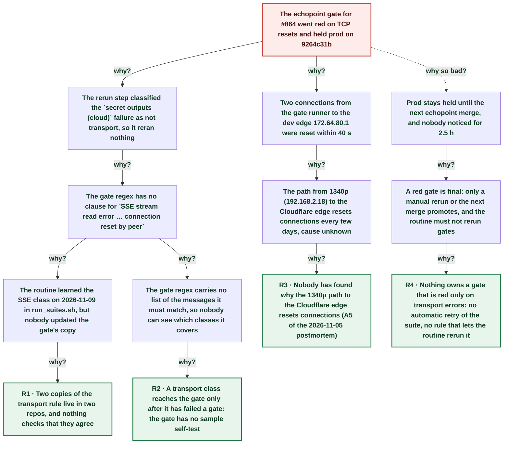

# Echopoint prod held: the gate's transport rerun did not know an SSE reset

| | |
|---|---|
| **Date** | 2026-11-13 |
| **Severity** | SEV4 |
| **Status** | In review |
| **Service** | ci-workflows (echopoint-test.yml post-deploy gate) |
| **Authors** | Nanostack routine (echopoint-investigation) |
| **Duration** | ~3h 03m (trigger to resolution) |
| **Time to detect** | ~2h 30m |
| **Time to mitigate** | ~2h 43m |

> Blameless: this document names systems, processes and missing guards, not people.

## Summary

The echopoint post-deploy gate for echopoint#864 failed on two TCP resets from the gate runner to the dev edge. One reset was a `Could not connect to` error, which the gate reruns. The other was `SSE stream read error … connection reset by peer`, which the gate's transport regex did not know, so the gate failed without a rerun and prod stayed on 9264c31b. The routine's own suite script had learned the SSE class on 2026-11-09, but the copy of the rule in the gate was never updated. The fix adds the SSE class to the gate and a sample self-test, and the routine now checks its samples against the gate regex before every run. This is a regression of the [2026-11-05 gate transport resets](http://nanostack-dev-1340p:4320/postmortems/01a1ae3d-6e68-7cfc-9fcd-d5a3847a180b) postmortem: its fix did not cover this class.

## Impact

No customer impact. Prod echopoint did not get echopoint#864 (log-level fix for invitation refusals); every later echopoint change waits behind the next green gate. Dev was deployed and healthy.

- **1** echopoint change held off prod
- **2** flows failed on TCP resets
- **0** leaked resources

## Trigger

At 21:38:50Z a TCP reset broke the SSE stream of `echopoint: secret outputs (cloud)` node `await-child`; at 21:41:10Z the gate's rerun step refused to rerun it as a non-transport failure.

## Detection

The deploy-failure alert job ran at 21:41:20Z, but nobody acts on it overnight. The routine found the red gate at its 2026-11-14T00:08Z run, when it reads every Deploy Router gate since the last run.

## Resolution

ci-workflows now counts `SSE stream read error … connection reset by peer` as transport and fails the step if its regex stops matching a known sample. Prod catches up at the next green echopoint gate (the routine does not rerun gates: a rerun promotes to prod).

## Timeline (UTC)

| Time | | Event |
|---|---|---|
| ~00:45 | T−7d 20h | **ci-workflows#42: gate reruns transport-only failures** Its regex copied the routine's `run_suites.sh` rule as it was then. ([link](https://github.com/nanostack-dev/ci-workflows/pull/42)) |
| ~20:05 | T−4d 01h | **run_suites.sh learns the SSE reset class** Not ported to the gate. |
| 21:05:04 | T−36m 09s | **echopoint#864 merged** ([link](https://github.com/nanostack-dev/echopoint/pull/864)) |
| 21:38:41 | T−2m 32s | **echopoint 223be8df deployed to dev** ([link](https://github.com/nanostack-dev/infra/actions/runs/43512401138)) |
| 21:38:50 | T−2m 23s | **SSE reset on secret outputs (cloud) await-child** `read tcp 192.168.2.18:33436->172.64.80.1:443: read: connection reset by peer` |
| 21:39:29 | T−1m 44s | **Reset on integration operation outputs create-ok** `Could not connect to apidev.echopoint.dev` (a known transport class). |
| 21:41:13 | T+0s | **Rerun step refuses; prod promotion skipped** `Flows failed on more than a transport error: 6d952ea9-…` ([link](https://github.com/nanostack-dev/infra/actions/runs/43512401138)) |
| 21:41:20 | T+7s | **Deploy-failure alert job runs; no one acts** |
| ~00:12 | T+2h 30m | **Routine reads the red gate log** |
| ~00:25 | T+2h 43m | **Leak check: none; regex fix tested locally** |
| ~00:45 | T+3h 03m | **Gate classifier fix merged in ci-workflows** |
| ~00:50 | T+3h 08m | **Routine checks gate regex against its samples** |

## Root cause analysis: the five whys

Start at the impact and ask why until the answer is something the team can change. Solid edges ask why it happened; dashed edges ask why the impact was as large as it was.

- **Problem:** The echopoint gate for #864 went red on TCP resets and held prod on 9264c31b
  - **Why?** The rerun step classified the `secret outputs (cloud)` failure as not transport, so it reran nothing _Evidence: Gate log: `Flows failed on more than a transport error: 6d952ea9-2dae-46f5-8dd5-3b8553315af2` (infra run 43512401138, job 132186071342)_
    - **Why?** The gate regex has no clause for `SSE stream read error … connection reset by peer` _Evidence: `transport='Could not connect to|Connection refused by|TLS handshake|Could not resolve host|Request to [^ ]+ timed out'` in echopoint-test.yml_
      - **Why?** The routine learned the SSE class on 2026-11-09 in run_suites.sh, but nobody updated the gate's copy _Evidence: run_suites.sh comment: `2026-11-09T20:0xZ: … an SSE reset during a dev deploy were left FAILED`; no ci-workflows change since #42 touches the regex_
        - **Why?** Two copies of the transport rule live in two repos, and nothing checks that they agree → **Root cause R1** (fixed by A1, A2, A3)
      - **Why?** The gate regex carries no list of the messages it must match, so nobody can see which classes it covers _Evidence: echopoint-test.yml before this fix: regex only, no samples or test_
        - **Why?** A transport class reaches the gate only after it has failed a gate: the gate has no sample self-test → **Root cause R2** (fixed by A1)
  - **Why?** Two connections from the gate runner to the dev edge 172.64.80.1 were reset within 40 s _Evidence: Gate log lines 471 and 475; same path as the 2026-11-05 resets and ledger row 76 (2026-11-09, 11-12)_
    - **Why?** The path from 1340p (192.168.2.18) to the Cloudflare edge resets connections every few days, cause unknown _Evidence: 2026-11-05 postmortem action A5 is still open_
      - **Why?** Nobody has found why the 1340p path to the Cloudflare edge resets connections (A5 of the 2026-11-05 postmortem) → **Root cause R3** (fixed by A4)
  - **Why so bad?** Prod stays held until the next echopoint merge, and nobody noticed for 2.5 h _Evidence: No Deploy Router run after 43512401138 up to 2026-11-14T00:08Z; prod /health 9264c31b_
    - **Why?** A red gate is final: only a manual rerun or the next merge promotes, and the routine must not rerun gates _Evidence: Routine Run notes: `The routine does not rerun a failed gate job (a rerun promotes to prod).`_
      - **Why?** Nothing owns a gate that is red only on transport errors: no automatic retry of the suite, no rule that lets the routine rerun it → **Root cause R4** (fixed by A5)

## Root causes

- **R1** Two copies of the transport rule live in two repos, and nothing checks that they agree
- **R2** A transport class reaches the gate only after it has failed a gate: the gate has no sample self-test
- **R3** Nobody has found why the 1340p path to the Cloudflare edge resets connections (A5 of the 2026-11-05 postmortem)
- **R4** Nothing owns a gate that is red only on transport errors: no automatic retry of the suite, no rule that lets the routine rerun it

## Contributing factors

- The gate decides on the first failure message of a flow only; a second reset on a known class would not change the verdict.
- The deploy-failure alert lands in Discord at night with nobody to read it.

## Lessons learned

### What went well

- The gate's TRANSPORT-RERUN logic and leak report from the 2026-11-05 postmortem worked for the known class.
- Every `always` cleanup in both failed flows completed, so nothing leaked.

### What went wrong

- A fix to one transport classifier was not carried to the other the same day.
- The 2026-11-05 fix was marked verified on two green gates that had no SSE reset, so verification proved nothing about this class.

### Where we got lucky

- The held change was a log-level fix; a security fix held the same way would have stayed off prod for hours.
- The reset `POST /flows` in `integration operation outputs` ran in a throwaway org that its cleanup deleted, so a flow applied before the reset leaves no live resource.

## Action items

| ID | Action | Type | Owner | Due | Status | Ticket | Fixes |
|---|---|---|---|---|---|---|---|
| A1 | Add the SSE reset class to the gate regex and a sample self-test that fails the step when the regex stops matching a known transport message | prevent | Nanostack routine (echopoint-investigation) | 2026-11-14 | done |  | R2, R1 |
| A2 | run_suites.sh preflight fetches the gate workflow and checks each of its own transport samples against the gate regex; prints GATE-TRANSPORT-DRIFT | detect | Nanostack routine (echopoint-investigation) | 2026-11-14 | done |  | R1 |
| A3 | flow-suite-testing skill: a transport class added to one classifier is added to the gate and its samples the same run | process | Nanostack routine (echopoint-investigation) | 2026-11-14 | done |  | R1 |
| A4 | Find why the 1340p path to 172.64.80.1 resets connections (carried over from 2026-11-05 A5) | prevent | infra maintainers | 2026-11-27 | open |  | R3 |
| A5 | Decide who reruns a gate that is red only on transport errors after its rerun: an automatic suite retry, or a rule that lets the routine rerun it | mitigate | infra maintainers | 2026-11-27 | open |  | R4 |

## Responders

- **Investigation**: Nanostack routine (echopoint-investigation)

## Messaging

### Internal

Echopoint gate for #864 went red on two TCP resets; the SSE reset was not in the gate's transport list, so it did not rerun and prod stayed on 9264c31b. Gate regex fixed with a sample self-test; prod catches up at the next green echopoint gate.

### Customers

None: dev and CI only.

## Supporting information

- [Atelier](http://nanostack-dev-1340p:4320/postmortems/01a1d767-8e63-71c4-af60-eb150efdba4c)
- [Deploy Router run 43512401138](https://github.com/nanostack-dev/infra/actions/runs/43512401138)
- [First postmortem (2026-11-05 gate transport resets)](http://nanostack-dev-1340p:4320/postmortems/01a1ae3d-6e68-7cfc-9fcd-d5a3847a180b)
- [ci-workflows#42](https://github.com/nanostack-dev/ci-workflows/pull/42)
