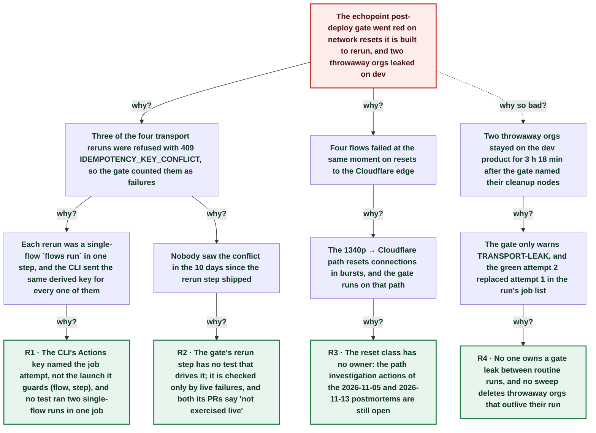

# Echopoint gate red on network resets: its transport reruns reused one idempotency key and got 409

| | |
|---|---|
| **Date** | 2026-11-16 |
| **Severity** | SEV4 |
| **Status** | In review |
| **Service** | ci-workflows echopoint-test.yml (echopoint post-deploy gate) + echopoint-cli |
| **Authors** | Nanostack routine (echopoint-investigation) |
| **Duration** | 8m 49s (trigger to resolution) |
| **Time to detect** | 27s |
| **Time to mitigate** | 5m 34s |

> Blameless: this document names systems, processes and missing guards, not people.

## Summary

On 2026-11-16 at 20:53Z the echopoint post-deploy gate on dev lost 4 of 65 flows to TCP resets between the 1340p runner and the Cloudflare edge. The gate reruns such flows once, but each rerun was a single-flow `echopoint flows run` in the same step, and the CLI derived one idempotency key per job attempt for all of them: the first rerun passed, the other three got 409 `IDEMPOTENCY_KEY_CONFLICT`, and the gate went red. A manual job rerun passed at 21:02Z. Prod was not held, because the deploy was a redeploy of the image prod already ran. Two reset cleanups leaked throwaway Anchor orgs on dev for 3 h 18 min, until this routine deleted them. echopoint-cli#106 (v4.1.1) and ci-workflows#53 give every launch its own key; the routine now reads every gate attempt for leaks.

## Impact

Dev and CI only. The red gate fired the deploy failure alert and needed a manual job rerun (9 min red). Prod was not held: the redeploy was of `sha-829f4b1`, already on prod since 16:50Z. Two throwaway Anchor organizations stayed on the dev Nanostack product for 3 h 18 min.

- **3 of 4** transport reruns refused with 409
- **9 min** gate red until the manual rerun passed
- **3 h 18 min** two leaked dev orgs before deletion

## Trigger

TCP resets from the 1340p runner (192.168.2.18) to the Cloudflare edge (172.64.80.1) failed 4 flows at once in the echopoint gate; the gate's rerun step then relaunched 4 single flows under one derived idempotency key.

## Detection

The gate job failed at 20:54:22Z and its `alert-deploy-failure` job ran at 20:54:24Z, so detection took 27 s from the first failed flow. The two `TRANSPORT-LEAK` warnings were seen by nobody: the gate only reports them, and its replacement attempt 2 hid attempt 1 from the run's job list. This routine found them at 00:10Z by reading attempt 1's log.

## Resolution

A human reran the failed job at 20:59:31Z; attempt 2 passed all flows at 21:02:46Z. echopoint-cli#106 (derive the key per step and per flow, released v4.1.1, Action `v1` now v4.2.0) and ci-workflows#53 (explicit `transport-rerun-<run>-<attempt>-<flow>` key) removed the cause by 22:26Z. The routine deleted both leaked orgs at 00:12Z, verified the fix live at 00:20Z, and added a gate-log scan to `run_suites.sh`.

## Timeline (UTC)

| Time | | Event |
|---|---|---|
| ~00:45 | T−10d 20h | **ci-workflows#42 adds the gate's transport rerun step** Each failed flow reruns with a plain `echopoint flows run <id>`, no explicit key. ([link](https://github.com/nanostack-dev/ci-workflows/pull/42)) |
| 20:50:20 | T−3m 37s | **Deploy Router redeploys echopoint sha-829f4b1 to dev** ([link](https://github.com/nanostack-dev/infra/actions/runs/43953894269/attempts/1)) |
| 20:52:07 | T−1m 50s | **Anchor gate: one reset, its single rerun passes** Same path (192.168.2.18 → 172.64.80.1); one rerun takes the free job key and passes. ([link](https://github.com/nanostack-dev/infra/actions/runs/43953787558)) |
| 20:53:57 | T+0s | **Echopoint gate: 4 flows fail on TCP resets** `Daily invitation email limit`, `Invitation email budget`, `Flow folders`, `HTTP call limit on Cloud`: 2 SSE reads, 1 POST, 1 PATCH in a poll. ([link](https://github.com/nanostack-dev/infra/actions/runs/43953894269/job/133603782485)) |
| 20:53:58 | T+1s | **Gate warns TRANSPORT-LEAK for two cleanup-org nodes** `1342edd0` and `d04abe74`: the org DELETE was reset. |
| 20:54:19 | T+22s | **First rerun (1342edd0) passes with the job's key** |
| 20:54:21 | T+24s | **Reruns 2-4 refused: 409 IDEMPOTENCY_KEY_CONFLICT** |
| 20:54:24 | T+27s | **Gate job red; alert-deploy-failure runs** |
| 20:59:31 | T+5m 34s | **Failed job rerun (attempt 2)** ([link](https://github.com/nanostack-dev/infra/actions/runs/43953894269/attempts/2)) |
| 21:02:46 | T+8m 49s | **Attempt 2: every echopoint flow passes** |
| 22:25:45 | T+1h 31m | **ci-workflows#53: explicit key per rerun** ([link](https://github.com/nanostack-dev/ci-workflows/pull/53)) |
| 22:26:38 | T+1h 32m | **echopoint-cli#106 released as v4.1.1** ([link](https://github.com/nanostack-dev/echopoint-cli/pull/106)) |
| 00:12:28 | T+3h 18m | **Routine deletes both leaked orgs (200 → 204 → 404)** |
| 00:21:35 | T+3h 27m | **Live check: 2 flows in one step + explicit key, no 409** |

## Root cause analysis: the five whys

Start at the impact and ask why until the answer is something the team can change. Solid edges ask why it happened; dashed edges ask why the impact was as large as it was.

- **Problem:** The echopoint post-deploy gate went red on network resets it is built to rerun, and two throwaway orgs leaked on dev
  - **Why?** Three of the four transport reruns were refused with 409 IDEMPOTENCY_KEY_CONFLICT, so the gate counted them as failures _Evidence: Gate log 20:54:20-21Z: `launch flow: unexpected status 409 … Idempotency key reused with different launch parameters`, then `failed again on its rerun`_
    - **Why?** Each rerun was a single-flow `flows run` in one step, and the CLI sent the same derived key for every one of them _Evidence: echopoint-cli#106: `deriveGitHubIdempotencyKey(flowIDs)` ignored its argument; `executeFlows` sent the base key unchanged for one flow_
      - **Why?** The CLI's Actions key named the job attempt, not the launch it guards (flow, step), and no test ran two single-flow runs in one job _Evidence: Behaviour since the CLI was first published (echopoint-cli#106 body); its new tests fail on the old derivation_ → **Root cause R1** (fixed by A1, A2, A6)
    - **Why?** Nobody saw the conflict in the 10 days since the rerun step shipped _Evidence: The routine's run log records gate reruns of one flow each (2026-11-12, 2026-11-16 anchor); one rerun takes the free job key and passes_
      - **Why?** The gate's rerun step has no test that drives it; it is checked only by live failures, and both its PRs say 'not exercised live' _Evidence: ci-workflows#42 and #53 Verification sections; the SAMPLES self-test checks only which errors count as transport_ → **Root cause R2** (fixed by A2, A3, A4)
  - **Why?** Four flows failed at the same moment on resets to the Cloudflare edge _Evidence: `read tcp 192.168.2.18:* -> 172.64.80.1:443: connection reset by peer`, 20:52:07Z (anchor gate) to 20:53:57Z, during anchor and echopoint deploys_
    - **Why?** The 1340p → Cloudflare path resets connections in bursts, and the gate runs on that path _Evidence: Same resets in the 2026-11-05 and 2026-11-13 gate postmortems_
      - **Why?** The reset class has no owner: the path investigation actions of the 2026-11-05 and 2026-11-13 postmortems are still open _Evidence: [2026-11-13 postmortem](http://nanostack-dev-1340p:4320/postmortems/01a1d767-8e63-71c4-af60-eb150efdba4c) A4/A5 open_ → **Root cause R3** (fixed by A7)
  - **Why so bad?** Two throwaway orgs stayed on the dev product for 3 h 18 min after the gate named their cleanup nodes _Evidence: Routine temp flows 00:12Z: GET 200, DELETE 204, GET 404 for `org_3MClO1WQ…` and `org_3MClFtjs…`_
    - **Why?** The gate only warns TRANSPORT-LEAK, and the green attempt 2 replaced attempt 1 in the run's job list _Evidence: `/runs/43953894269/jobs` lists attempt 2 only; attempt 1 needs `/attempts/1/jobs`_
      - **Why?** No one owns a gate leak between routine runs, and no sweep deletes throwaway orgs that outlive their run _Evidence: Sweep action A5 of the 2026-10-21 transport postmortem is still open; the session that reran and fixed the gate left the leaks_ → **Root cause R4** (fixed by A4, A5, A6)

## Root causes

- **R1** The CLI's Actions key named the job attempt, not the launch it guards (flow, step), and no test ran two single-flow runs in one job
- **R2** The gate's rerun step has no test that drives it; it is checked only by live failures, and both its PRs say 'not exercised live'
- **R3** The reset class has no owner: the path investigation actions of the 2026-11-05 and 2026-11-13 postmortems are still open
- **R4** No one owns a gate leak between routine runs, and no sweep deletes throwaway orgs that outlive their run

## Contributing factors

- The redeploy at 20:50Z ran together with anchor dev+prod deploys and an echopoint prod redeploy (20:49-20:57Z) on the same host path.
- The fix session wrote no ledger row or postmortem, so the leaks and the 409 were not linked until the next routine run.

## Lessons learned

### What went well

- Another session found the 409, fixed both the CLI and the gate with tests, and shipped both within 1 h 32 min of the red gate.
- The gate's TRANSPORT-LEAK lines named the exact flow and node, so the leaked orgs were easy to find and delete.

### What went wrong

- The leaks waited for the next routine run, because the gate reports leaks but nobody acts on them in between.
- The rerun step shipped on 2026-11-06 with no test of its launch path, only of its error classification.

### Where we got lucky

- The redeploy carried the image prod already ran; on a feature merge, prod would have been held until a human reran the job.
- The 409 refused the launch before any execution, so no rerun replayed or duplicated a side effect.
- The leaked orgs were throwaway orgs on the shared dev product; a reset DELETE of a shared fixture would have left a real one half-deleted.

## Action items

| ID | Action | Type | Owner | Due | Status | Ticket | Fixes |
|---|---|---|---|---|---|---|---|
| A1 | Derive the Actions idempotency key per step and per flow; tests for two flows in one step and one flow in two steps | prevent | echopoint-cli maintainers |  | done | [echopoint-cli#106](https://github.com/nanostack-dev/echopoint-cli/pull/106) | R1 |
| A2 | Gate reruns pass an explicit transport-rerun-<run>-<attempt>-<flow> key | prevent | ci-workflows maintainers |  | done | [ci-workflows#53](https://github.com/nanostack-dev/ci-workflows/pull/53) | R1, R2 |
| A3 | A dispatchable self-test of echopoint-test.yml that forces two or more transport reruns (stub CLI or a flow that resets) and asserts each relaunches | prevent | ci-workflows maintainers | 2026-11-30 | open |  | R2 |
| A4 | run_suites.sh reads every Deploy Router gate attempt since the last run and prints GATE-TRANSPORT-LEAK and GATE-RERUN-REFUSED lines | detect | Nanostack routine (echopoint-investigation) |  | done |  | R4, R2 |
| A5 | Sweep throwaway Anchor orgs and product users on the shared dev product that outlive their run by more than 1 h | mitigate | infra and anchor maintainers | 2026-11-30 | open |  | R4 |
| A6 | flow-suite-testing skill: give every CI rerun its own idempotency key; whoever reruns a gate deletes its TRANSPORT-LEAK resources | process | Nanostack routine (echopoint-investigation) |  | done |  | R4, R1 |
| A7 | Own the 1340p → Cloudflare reset investigation (A4/A5 of the 2026-11-13 postmortem) | prevent | infra maintainers | 2026-11-27 | open |  | R3 |

## Responders

- **Gate rerun**: repository maintainer (manual job rerun)
- **Fix**: agent session (echopoint-cli#106, ci-workflows#53)
- **Postmortem, leak cleanup**: Nanostack routine (echopoint-investigation)

## Messaging

### Internal

Echopoint dev gate went red on 2026-11-16 20:54Z: 4 flows lost to TCP resets, and 3 of the 4 reruns were refused (409 IDEMPOTENCY_KEY_CONFLICT) because the CLI reused one key per job. Rerun passed 21:02Z; prod unaffected. Fixed by echopoint-cli#106 and ci-workflows#53. Two leaked dev orgs deleted 2026-11-17 00:12Z.

### Customers

None: dev and CI only.

## Supporting information

- [Atelier](http://nanostack-dev-1340p:4320/postmortems/01a1e6e5-ede5-7c99-914f-85d09c438aa9)
- [Red gate attempt 1](https://github.com/nanostack-dev/infra/actions/runs/43953894269/attempts/1)
- [echopoint-cli#106](https://github.com/nanostack-dev/echopoint-cli/pull/106)
- [ci-workflows#53](https://github.com/nanostack-dev/ci-workflows/pull/53)
- [Earlier: 2026-11-13 gate SSE reset postmortem](http://nanostack-dev-1340p:4320/postmortems/01a1d767-8e63-71c4-af60-eb150efdba4c)
- [Earlier: 2026-11-05 gate transport resets postmortem](http://nanostack-dev-1340p:4320/postmortems/01a1ae3d-6e68-7cfc-9fcd-d5a3847a180b)
