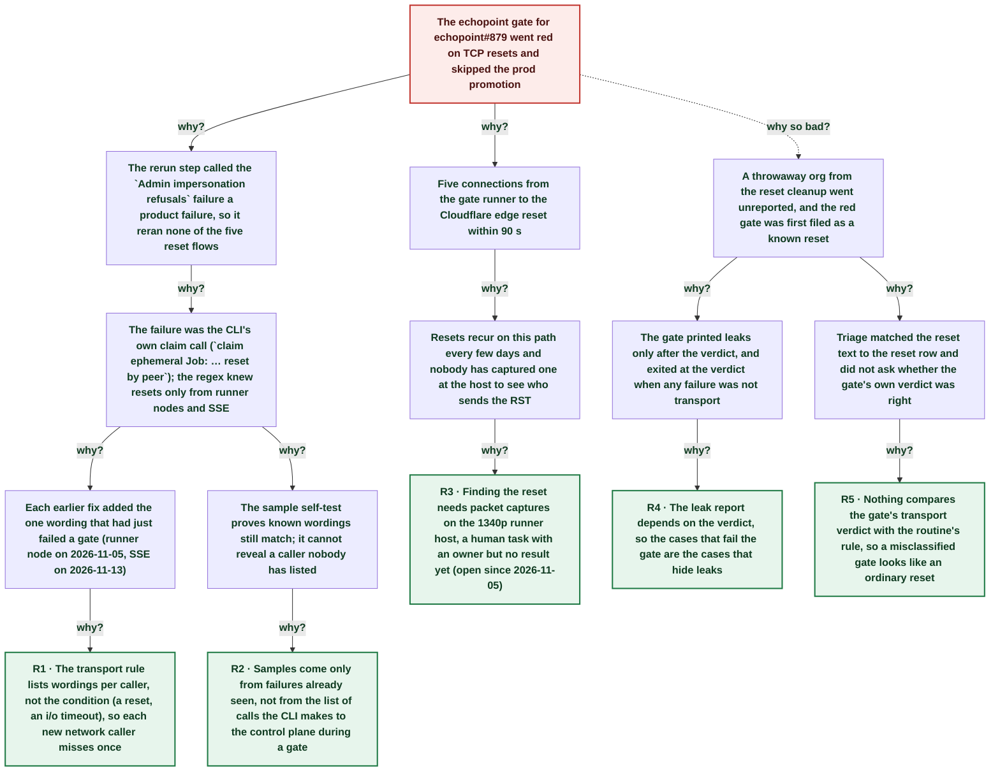

# Echopoint gate held a deploy on a reset of the CLI's own ephemeral claim

| | |
|---|---|
| **Date** | 2026-11-19 |
| **Severity** | SEV4 |
| **Status** | In review |
| **Service** | ci-workflows (echopoint-test.yml post-deploy gate) |
| **Authors** | Nanostack routine (echopoint-investigation) |
| **Duration** | 5m 44s (trigger to resolution) |
| **Time to detect** | 1m 37s |
| **Time to mitigate** | 2m 32s |

> Blameless: this document names systems, processes and missing guards, not people.

## Summary

At 02:51-02:53Z five connections from the gate runner to the Cloudflare edge reset during the echopoint gate for echopoint#879. Four failures read `Could not connect to …` and were transport by the gate's rule. The fifth was the CLI's own call `claim ephemeral Job: Post …/claim: … connection reset by peer`, which the regex did not list, so the gate reran nothing and held prod. The dispatch for echopoint#880, 45 s later, carried #879 too and promoted it at 02:57Z, so prod waited 3.5 min. The gate's leak report also never ran, because it sits after the verdict, and a throwaway org from a reset cleanup stayed until the routine deleted it at 06:2xZ. This is the third time the transport rule missed a new wording (2026-11-05 runner nodes, 2026-11-13 SSE, now the CLI claim).

## Impact

No customer impact. Prod echopoint promotion of echopoint#879 skipped by one gate; the next dispatch promoted the same code 3.5 min later. One throwaway Anchor org on dev left unreported for about 3.5 h.

- **1** red gate (infra run 44447148308)
- **3.5 min** prod held
- **5** flows reset, 1 misclassified
- **1** throwaway org leak not reported

## Trigger

At 02:51:44Z the CLI's claim of an ephemeral execution for `Admin impersonation refusals` (fc768d01) got `connection reset by peer` from 172.64.80.1; at 02:53:19Z the rerun step classified it as a product failure and failed the gate.

## Detection

The deploy-failure alert ran at 02:53:21Z, overnight. grafana-watch saw the red gate at its next run but filed it on the suite reset row as "same trigger". The routine found the misclassification at its 2026-11-19T06:08Z run while reading the gate log line by line.

## Resolution

The gate's regex now counts `connection reset by peer` and TCP `i/o timeout` as transport wherever they appear, with samples for the claim and launch calls, and reports leaks of transport-failed flows before its verdict. The routine's run_suites.sh uses the same rule, reruns CLI control-plane failures (claim, complete) like launch failures, and prints `GATE-TRANSPORT-MISSED` for any gate that refused a flow its own rule calls transport.

## Timeline (UTC)

| Time | | Event |
|---|---|---|
| ~23:50 | T−5d 03h | **ci-workflows#51 adds the SSE reset wording to the gate** One more wording, not the reset condition itself. ([link](https://github.com/nanostack-dev/ci-workflows/pull/51)) |
| 02:47:23 | T−4m 21s | **echopoint#879 merged (remote MCP endpoint)** ([link](https://github.com/nanostack-dev/echopoint/pull/879)) |
| 02:49:02 | T−2m 42s | **echopoint#880 merged** ([link](https://github.com/nanostack-dev/echopoint/pull/880)) |
| 02:50:57 | T−47s | **Echopoint gate starts on dev (run 44447148308)** ([link](https://github.com/nanostack-dev/infra/actions/runs/44447148308)) |
| 02:51:44 | T+0s | **Reset on the CLI's ephemeral claim of fc768d01** `claim ephemeral Job: Post "https://api.echopoint.dev/runner/ephemeral/executions/01a1f1b7-…/claim": read tcp 192.168.2.18:48938->172.64.80.1:443: read: connection reset by peer` ([link](https://github.com/nanostack-dev/infra/actions/runs/44447148308/job/135302299274)) |
| 02:53:07 | T+1m 23s | **Reset on `Cursor searches: webhooks and resources` cleanup-org** DELETE of org_3MJ7OWsBemr1YbZ5TRE3d8A5KFd lost; four flows failed in all on `Could not connect to`. |
| 02:53:19 | T+1m 35s | **Rerun step refuses: "more than a transport error"** `Flows failed on more than a transport error: fc768d01`. No rerun, no TRANSPORT-LEAK report (it ran after the verdict). ([link](https://github.com/nanostack-dev/infra/actions/runs/44447148308/job/135302299274)) |
| 02:53:21 | T+1m 37s | **alert-deploy-failure posts to Discord** ([link](https://github.com/nanostack-dev/infra/actions/runs/44447148308)) |
| 02:54:16 | T+2m 32s | **Gate for echopoint#880 starts (run 44447240413)** ([link](https://github.com/nanostack-dev/infra/actions/runs/44447240413)) |
| 02:57:28 | T+5m 44s | **Prod echopoint deployed with #879 and #880** ([link](https://github.com/nanostack-dev/infra/actions/runs/44447240413)) |
| ~06:15 | T+3h 23m | **Routine reads the gate log and finds the claim wording** |
| ~06:25 | T+3h 33m | **Leaked throwaway org deleted by a temp flow** |
| ~06:40 | T+3h 48m | **Gate rule matches the reset condition; leaks before verdict** |

## Root cause analysis: the five whys

Start at the impact and ask why until the answer is something the team can change. Solid edges ask why it happened; dashed edges ask why the impact was as large as it was.

- **Problem:** The echopoint gate for echopoint#879 went red on TCP resets and skipped the prod promotion
  - **Why?** The rerun step called the `Admin impersonation refusals` failure a product failure, so it reran none of the five reset flows _Evidence: Gate log: `##[error]Flows failed on more than a transport error: fc768d01-ba1c-4bac-8178-41ca2ba144a7.` (job 135302299274)_
    - **Why?** The failure was the CLI's own claim call (`claim ephemeral Job: … reset by peer`); the regex knew resets only from runner nodes and SSE _Evidence: `transport='Could not connect to|Connection refused by|TLS handshake|Could not resolve host|Request to [^ ]+ timed out|SSE stream read error: .*connection reset by peer'` in echopoint-test.yml at 4723f2a_
      - **Why?** Each earlier fix added the one wording that had just failed a gate (runner node on 2026-11-05, SSE on 2026-11-13) _Evidence: ci-workflows#42 and #51 each add one alternative; the 2026-11-13 postmortem action reads `Add the SSE reset class to the gate regex`_
        - **Why?** The transport rule lists wordings per caller, not the condition (a reset, an i/o timeout), so each new network caller misses once → **Root cause R1** (fixed by A1, A4)
      - **Why?** The sample self-test proves known wordings still match; it cannot reveal a caller nobody has listed _Evidence: SAMPLES held 7 messages, all from runner nodes and SSE; none from the CLI's launch, claim or complete calls_
        - **Why?** Samples come only from failures already seen, not from the list of calls the CLI makes to the control plane during a gate → **Root cause R2** (fixed by A1, A3)
  - **Why?** Five connections from the gate runner to the Cloudflare edge reset within 90 s _Evidence: `read tcp 192.168.2.18:* ->172.64.80.1:443: read: connection reset by peer` at 02:51:44, 02:51:49, 02:51:52, 02:53:05 and 02:53:07Z_
    - **Why?** Resets recur on this path every few days and nobody has captured one at the host to see who sends the RST _Evidence: Ledger suite transport row: resets on 2026-11-05, -07, -08, -10, -11, -12, -13, -15, -18, -19; human action A7 of the 2026-11-16 postmortem, due 2026-11-27_
      - **Why?** Finding the reset needs packet captures on the 1340p runner host, a human task with an owner but no result yet (open since 2026-11-05) → **Root cause R3** (fixed by A5)
  - **Why so bad?** A throwaway org from the reset cleanup went unreported, and the red gate was first filed as a known reset _Evidence: No `TRANSPORT-LEAK` line in job 135302299274; ledger row 53 note 2026-11-19T02:53Z `same trigger, logged here`_
    - **Why?** The gate printed leaks only after the verdict, and exited at the verdict when any failure was not transport _Evidence: echopoint-test.yml at 4723f2a: `exit 1` on `other` before the `for flow in $failed` leak loop_
      - **Why?** The leak report depends on the verdict, so the cases that fail the gate are the cases that hide leaks → **Root cause R4** (fixed by A2)
    - **Why?** Triage matched the reset text to the reset row and did not ask whether the gate's own verdict was right _Evidence: run_suites.sh gate scan printed only TRANSPORT-LEAK and RERUN-REFUSED lines; no check compared the gate's verdict with the routine's rule_
      - **Why?** Nothing compares the gate's transport verdict with the routine's rule, so a misclassified gate looks like an ordinary reset → **Root cause R5** (fixed by A3)

## Root causes

- **R1** The transport rule lists wordings per caller, not the condition (a reset, an i/o timeout), so each new network caller misses once
- **R2** Samples come only from failures already seen, not from the list of calls the CLI makes to the control plane during a gate
- **R3** Finding the reset needs packet captures on the 1340p runner host, a human task with an owner but no result yet (open since 2026-11-05)
- **R4** The leak report depends on the verdict, so the cases that fail the gate are the cases that hide leaks
- **R5** Nothing compares the gate's transport verdict with the routine's rule, so a misclassified gate looks like an ordinary reset

## Contributing factors

- The impersonation flow's claim happens before any node runs, so the CLI reports the error itself; runner wordings never cover it.
- The deploy-failure alert lands in Discord at night with nobody to read it.

## Lessons learned

### What went well

- The gate's sample self-test and the routine's drift check kept both rules in step for the known wordings.
- Reading the gate log line by line, not only the ledger, found the real cause.

### What went wrong

- Two earlier postmortems fixed the wording that failed, not the transport condition behind it.
- A fix that names one caller left the next caller (the CLI itself) uncovered.

### Where we got lucky

- echopoint#880 merged 2 min after #879, so its dispatch promoted the same code 3.5 min later. Without it, prod would have waited for the next echopoint merge, hours later.
- The leaked org was a throwaway with no data; a leaked product user or API key would carry real access.

## Action items

| ID | Action | Type | Owner | Due | Status | Ticket | Fixes |
|---|---|---|---|---|---|---|---|
| A1 | Gate regex matches `connection reset by peer` and TCP `i/o timeout` anywhere, with claim and launch samples | prevent | Nanostack routine (echopoint-investigation) | 2026-11-19 | done | [ci-workflows#56](https://github.com/nanostack-dev/ci-workflows/pull/56) | R1, R2 |
| A2 | Gate prints TRANSPORT-LEAK for every transport-failed flow before its verdict | mitigate | Nanostack routine (echopoint-investigation) | 2026-11-19 | done | [ci-workflows#56](https://github.com/nanostack-dev/ci-workflows/pull/56) | R4 |
| A3 | run_suites.sh uses the same condition rule, reruns CLI claim/complete failures like launch failures, and prints GATE-TRANSPORT-MISSED when a gate refused a flow its rule calls transport | detect | Nanostack routine (echopoint-investigation) | 2026-11-19 | done |  | R5, R2 |
| A4 | Skill line: classify transport by condition, never by caller wording | process | Nanostack routine (echopoint-investigation) | 2026-11-19 | done | [skills#71](https://github.com/nanostack-dev/skills/pull/71) | R1 |
| A5 | Find why the 1340p → Cloudflare edge path resets connections (same as 2026-11-16 A7) | prevent | Infra maintainers | 2026-11-27 | open |  | R3 |

## Responders

- **Investigation**: Nanostack routine (echopoint-investigation)

## Messaging

### Internal

Echopoint gate for #879 went red on five TCP resets; one was the CLI's own claim call, a wording the gate's transport rule did not list, so nothing reran and the leak report was skipped. #880's gate promoted the same code 3.5 min later. Gate now classifies resets and i/o timeouts anywhere and reports leaks before its verdict.

### Customers

None: dev and CI only.

## Supporting information

- [Atelier](http://nanostack-dev-1340p:4320/postmortems/01a1f277-f56b-7be8-8c5c-db803d248dba)
- [Deploy Router run 44447148308 (red)](https://github.com/nanostack-dev/infra/actions/runs/44447148308)
- [Deploy Router run 44447240413 (green, promoted)](https://github.com/nanostack-dev/infra/actions/runs/44447240413)
- [Previous: 2026-11-13 gate SSE reset not transport](http://nanostack-dev-1340p:4320/postmortems/01a1d767-8e63-71c4-af60-eb150efdba4c)
- [First: 2026-11-05 gate transport resets](postmortems/2026-11-05-gate-transport-resets.md)
