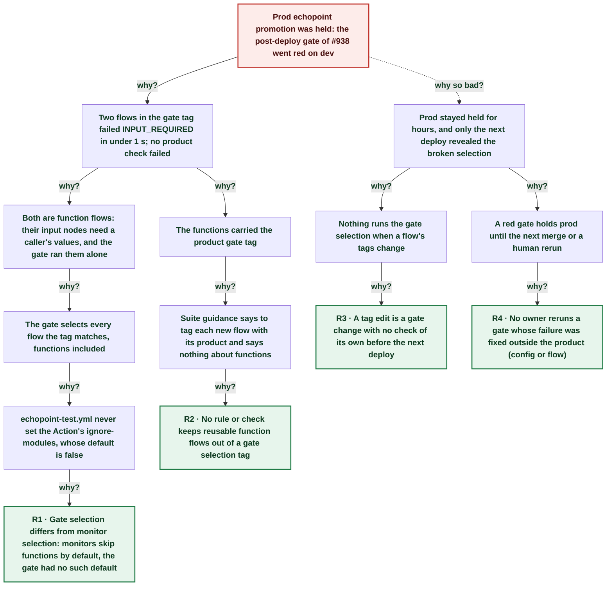

# Echopoint gate red, prod held: the gate ran two tagged function flows without their caller's inputs

| | |
|---|---|
| **Date** | 2026-11-21 |
| **Severity** | SEV4 |
| **Status** | In review |
| **Service** | ci-workflows echopoint-test.yml (echopoint post-deploy gate) |
| **Authors** | Nanostack routine (echopoint-investigation) |
| **Duration** | ~2h 40m (trigger to resolution) |
| **Time to detect** | 5s |
| **Time to mitigate** | ~2h 40m |

> Blameless: this document names systems, processes and missing guards, not people.

## Summary

At 03:32Z two new function flows, `Throwaway organization` and `Delete throwaway organization`, were saved with the `echopoint` gate tag. The echopoint post-deploy gate of #938 (04:01Z) selected them, ran each alone with no inputs, and both failed `INPUT_REQUIRED`; the other 102 flows passed. The gate held prod echopoint on d0d34f35, so #938 (drops `flow_versions.published_at`) stayed on dev only. The gate never passed the Action's `ignore-modules`, which defaults to false, while monitors skip functions by default. ci-workflows now skips function flows by default, the local suite script does the same and warns on a tagged function, and the flow-suite skill says functions stay out of gate selections.

## Impact

Dev only. Prod echopoint promotion was held from 04:05Z; #938 stayed on dev. No customer impact: prod kept the previous build. Every later echopoint backend change would have stopped at dev the same way.

- **2 of 104** gate flows failed (both functions)
- **0** product failures

## Trigger

The echopoint gate of Deploy Router run 44863900081 (#938) ran the two tagged function flows alone; each failed `INPUT_REQUIRED` in under 1 s.

## Detection

The gate's `alert-deploy-failure` job ran at 04:05Z, during the night. The echopoint-investigation routine found it at 06:12Z on its next 6-hourly run. Nothing ran the gate selection between the tag change (03:32Z) and the next deploy.

## Resolution

ci-workflows `echopoint-test.yml` passes `ignore-modules: true` by default, so the next echopoint gate skips function flows. Prod receives #938 at the next green echopoint gate (next backend merge or a rerun by a human); the routine does not rerun gates.

## Timeline (UTC)

| Time | | Event |
|---|---|---|
| 03:32:15 | T−32m 43s | **Function `Delete throwaway organization` saved, tag echopoint** Flow `e3a0993a`, role `function`, an `input` node requiring `orgId`. ([link](https://api.echopoint.dev/flows/e3a0993a-a1ff-430e-af8a-215bd3a6748d)) |
| 03:32:38 | T−32m 20s | **Function `Throwaway organization` saved, tag echopoint** Flow `765223ce`, role `function`, input `name` required. Caller `Organization analytics windows and bounds` (`c62760dd`) switched to both at 03:38Z. ([link](https://api.echopoint.dev/flows/765223ce-15f0-422f-83b9-a6e51ff6bb4f)) |
| 03:54:47 | T−10m 11s | **echopoint#938 merged (drop published_at)** ([link](https://github.com/nanostack-dev/echopoint/pull/938)) |
| 04:00:12 | T−4m 46s | **Deploy Router run 44863900081 starts** ([link](https://github.com/nanostack-dev/infra/actions/runs/44863900081)) |
| 04:01:18 | T−3m 40s | **Runner: INPUT_REQUIRED input "name", then "orgId"** ([link](https://github.com/nanostack-dev/infra/actions/runs/44863900081/job/136723437774)) |
| 04:04:58 | T+0s | **Gate verdict red: 102 passed, 2 functions failed** `Flows failed on more than a transport error: 765223ce… e3a0993a…`. `deploy-echopoint-prod` skipped. ([link](https://github.com/nanostack-dev/infra/actions/runs/44863900081/job/136723437774)) |
| 04:05:03 | T+5s | **alert-deploy-failure job runs** ([link](https://github.com/nanostack-dev/infra/actions/runs/44863900081)) |
| ~06:12 | T+2h 07m | **Routine reads the gate log, finds role function** |
| ~06:45 | T+2h 40m | **ci-workflows gate skips function flows by default** |
| ~06:45 | T+2h 40m | **Next echopoint gate can pass; prod waits for it** |

## Root cause analysis: the five whys

Start at the impact and ask why until the answer is something the team can change. Solid edges ask why it happened; dashed edges ask why the impact was as large as it was.

- **Problem:** Prod echopoint promotion was held: the post-deploy gate of #938 went red on dev
  - **Why?** Two flows in the gate tag failed INPUT_REQUIRED in under 1 s; no product check failed _Evidence: Gate log: `✗ Flow 765223ce…: failed (3ms)` `input "name" is required`; 102 `✓ Flow` lines_
    - **Why?** Both are function flows: their input nodes need a caller's values, and the gate ran them alone _Evidence: `flows get`: `role: function`, nodes `input` … `output`; caller `c62760dd` passes `name`/`orgId` and passed in the same gate_
      - **Why?** The gate selects every flow the tag matches, functions included _Evidence: Gate log line 94: `ignore-modules: false`_
        - **Why?** echopoint-test.yml never set the Action's ignore-modules, whose default is false _Evidence: ci-workflows `echopoint-test.yml` at main: no `ignore-modules`; echopoint-cli `flow_run.go` flag default false_
          - **Why?** Gate selection differs from monitor selection: monitors skip functions by default, the gate had no such default → **Root cause R1** (fixed by A1, A2)
    - **Why?** The functions carried the product gate tag _Evidence: `tags: ["echopoint"]` on both; the other 15 functions in the workspace are untagged_
      - **Why?** Suite guidance says to tag each new flow with its product and says nothing about functions _Evidence: skills `flow-suite-testing/SKILL.md` step 8 ("Connect the gate"); routine step 4 "tag it with its product"_
        - **Why?** No rule or check keeps reusable function flows out of a gate selection tag → **Root cause R2** (fixed by A2, A3)
  - **Why so bad?** Prod stayed held for hours, and only the next deploy revealed the broken selection _Evidence: Tag change 03:32Z; first run of the tag 04:01Z inside a deploy; routine run 06:12Z_
    - **Why?** Nothing runs the gate selection when a flow's tags change _Evidence: Gate runs only from Deploy Router; run_suites.sh runs every 6 h; same gap as the 2026-11-21 role-rename postmortem A7_
      - **Why?** A tag edit is a gate change with no check of its own before the next deploy → **Root cause R3** (fixed by A4)
    - **Why?** A red gate holds prod until the next merge or a human rerun _Evidence: Routine rule: it does not rerun a failed gate job (a rerun promotes to prod)_
      - **Why?** No owner reruns a gate whose failure was fixed outside the product (config or flow) → **Root cause R4** (fixed by A5)

## Root causes

- **R1** Gate selection differs from monitor selection: monitors skip functions by default, the gate had no such default
- **R2** No rule or check keeps reusable function flows out of a gate selection tag
- **R3** A tag edit is a gate change with no check of its own before the next deploy
- **R4** No owner reruns a gate whose failure was fixed outside the product (config or flow)

## Contributing factors

- The role rename (echopoint#930, 2026-11-20) made functions first-class one day earlier, and another session converted the throwaway-org pattern into functions overnight.
- The local suite script `run_suites.sh` also ran tags without `--ignore-modules`, so it would have failed the same way instead of matching monitors.

## Lessons learned

### What went well

- The gate verdict named both flows and the exact input error, so the cause was clear from one log.
- The caller flow `c62760dd` passed in the same gate: the functions themselves work.

### What went wrong

- Gate, monitors and the local script each chose their own flow selection rule.
- The tag change and the deploy were 22 minutes apart, and nobody ran the tag in between.

### Where we got lucky

- The held change was a column drop with no prod caller; a held security fix would have stayed off prod the same way.
- Both functions fail fast and own nothing before their input check, so the failed runs leaked no organization.

## Action items

| ID | Action | Type | Owner | Due | Status | Ticket | Fixes |
|---|---|---|---|---|---|---|---|
| A1 | echopoint-test.yml input `ignore_modules`, default true, passed to the Action (gate skips function flows) | prevent | Nanostack routine (echopoint-investigation) | 2026-11-21 | done |  | R1 |
| A2 | run_suites.sh passes `--ignore-modules` and prints `FUNCTION-IN-TAG <tag> <flow>` for a tagged function | detect | Nanostack routine (echopoint-investigation) | 2026-11-21 | done |  | R1, R2 |
| A3 | flow-suite-testing skill: a reusable function stays out of the gate selection; the selection skips functions | process | Nanostack routine (echopoint-investigation) | 2026-11-21 | done |  | R2 |
| A4 | Run the gate tag when a flow in it is saved with a new tag or role (pre-deploy selection check) | detect | infra maintainers | 2026-12-05 | open |  | R3 |
| A5 | Name an owner who reruns a gate whose failure was fixed outside the product | process | infra maintainers | 2026-11-28 | open |  | R4 |

## Responders

- **Investigation**: Nanostack routine (echopoint-investigation)

## Messaging

### Internal

Echopoint gate of #938 red on two function flows tagged echopoint (no inputs); prod held on d0d34f35. Gate now skips function flows by default; prod gets #938 at the next green echopoint gate.

### Customers

None: dev and CI only.

## Supporting information

- [Gate run 44863900081](https://github.com/nanostack-dev/infra/actions/runs/44863900081)
- [echopoint#938](https://github.com/nanostack-dev/echopoint/pull/938)
